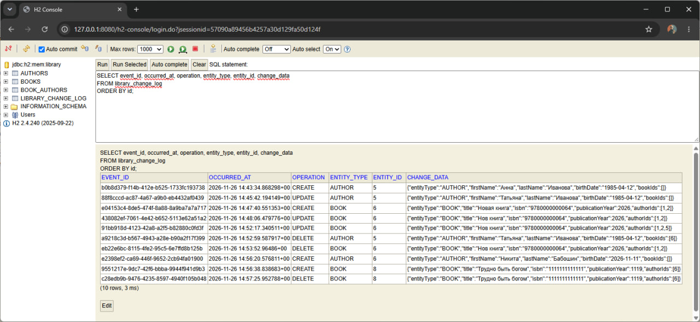
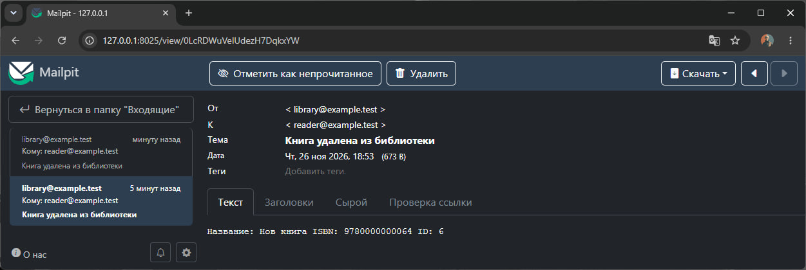

# Библиотека

Веб-приложение для ведения каталога книг и авторов. Разработано для практической работы № 2 «Приложение на Spring» по курсу «Архитектура корпоративных систем».

## Возможности

- Просмотр, добавление, редактирование и удаление книг и авторов.
- Поиск книг по названию, ISBN и автору; поиск авторов по имени и фамилии.
- Выбор нескольких авторов для одной книги и просмотр книг каждого автора.
- Проверка обязательных полей, уникальности ISBN, года издания и даты рождения.
- Подтверждение удаления и уведомления о результате операции.

Удаление книги не удаляет её авторов. При удалении автора его книги сохраняются, удаляются только связи с этим автором.

## Технологии и структура

Java 21, Spring Boot 4.1.2, Spring MVC, Thymeleaf, Spring Data JPA, Hibernate, Jakarta Validation, Lombok и H2. Сборка выполняется Maven.

Приложение разделено на три слоя:

| Слой | Реализация |
| --- | --- |
| Данные | JPA-сущности `Athor`, `Book` и репозитории `AuthorRepository`, `BookRepository` |
| Бизнес-логика | Транзакционные Spring-сервисы `AuthorService`, `BookService` |
| Представление | MVC-контроллеры, формы `AuthorForm`, `BookForm` и HTML-шаблоны Thymeleaf |

У автора хранятся имя, фамилия и дата рождения; у книги — название, ISBN и год издания. Сущности связаны отношением многие ко многим через таблицу `book_authors`.

Шаблоны находятся в `src/main/resources/templates`, общий CSS — в `src/main/resources/static/css/style.css`. Сообщения об ошибках преобразования полей заданы в Java-конфигурации `MessageConfig`.

## Выполненные задания

Условия работы: [02. Spring.pdf](../Задания/02.%20Spring.pdf).

| № | Задание | Реализация |
| --- | --- | --- |
| 1 | Выбрать предметную область, создать минимум две сущности и скрипт БД | Модель библиотеки: авторы и книги. Скрипт `src/main/resources/shema.sql` создаёт таблицы и добавляет начальные данные. |
| 2 | Подготовить Java Beans для Hibernate | Сущности размечены JPA-аннотациями; Lombok создаёт методы доступа и конструкторы без аргументов. Настроена двусторонняя связь многие ко многим. |
| 3 | Реализовать бизнес-слой на Spring Beans | Сервисы предоставляют поиск, сохранение и удаление данных, управляют транзакциями и связями сущностей. |
| 4 | Реализовать представление на Spring MVC | Контроллеры и страницы Thymeleaf предоставляют списки, поиск и формы создания и редактирования. |
| 5 | Обеспечить совместную работу приложения | При запуске создаётся БД, Hibernate проверяет схему; операции с книгами и авторами доступны через веб-интерфейс. |

## Запуск

Требуются JDK 21 и Maven 3.9 или новее. Порт `8080` должен быть свободен. При первой сборке нужен доступ к интернету для загрузки зависимостей.

Для практической работы № 4 перед запуском приложения подготовьте локальный брокер и Mailpit по инструкции в разделе [«Практическая работа № 4»](#практическая-работа--4-java-message-service).

Из корня репозитория перейдите в каталог приложения и проверьте версии:

```powershell
cd library-project
java -version
mvn -version
```

Maven должен использовать Java 21. Если выбрана другая версия, задайте путь к установленному JDK в текущем сеансе PowerShell, например:

```powershell
$env:JAVA_HOME = "C:\Program Files\Java\jdk-21.0.12.1"
$env:Path = "$env:JAVA_HOME\bin;$env:Path"
```

Запустите приложение:

```powershell
mvn spring-boot:run
```

Откройте [http://localhost:8080](http://localhost:8080). Разделы приложения:

- [Книги](http://localhost:8080/books).
- [Авторы](http://localhost:8080/authors).

Для остановки нажмите `Ctrl+C` в терминале, в котором запущено приложение.

Альтернативный запуск из собранного JAR, из каталога `library-project`:

```powershell
mvn clean package
java -jar target/library-project-0.0.1-SNAPSHOT.jar
```

## База данных

H2 работает в памяти процесса: отдельная установка сервера БД не требуется. При каждом запуске Spring автоматически выполняет `shema.sql`, создавая 4 авторов, 5 книг и 7 связей. ISBN в начальных данных — учебные примеры.

После остановки приложения изменения данных теряются. Следующий запуск восстанавливает начальную коллекцию из скрипта.

Для просмотра БД откройте [консоль H2](http://localhost:8080/h2-console) во время работы приложения и подключитесь:

| Поле | Значение |
| --- | --- |
| Driver Class | `org.h2.Driver` |
| JDBC URL | `jdbc:h2:mem:library` |
| User Name | `sa` |
| Password | Оставить пустым |

Пример запроса для просмотра книг и их авторов:

```sql
SELECT b.title, b.publication_year, a.first_name, a.last_name
FROM books b
JOIN book_authors ba ON ba.book_id = b.id
JOIN authors a ON a.id = ba.author_id
ORDER BY b.title, a.last_name, a.first_name;
```

## Практическая работа № 3 «RESTful веб-сервис»

Условия работы — [03. REST.pdf](../Задания/03.%20REST.pdf).

### Выбор технологии

| Критерий | Jakarta REST (JAX-RS) | Spring REST |
| --- | --- | --- |
| Маршрутизация | Ресурсы с `@Path` и аннотациями `@GET`, `@POST`, `@PUT`, `@DELETE` | `@RestController` и аннотации Spring MVC, например `@GetMapping` и `@PostMapping` |
| JSON и XML | `@Consumes` и `@Produces` определяют форматы, а тело обрабатывают провайдеры `MessageBodyReader` и `MessageBodyWriter`, например JSON-B и JAXB | `consumes` и `produces` определяют форматы, а тело обрабатывают `HttpMessageConverter`. В библиотеке это Jackson и Jackson XML |
| Интеграция | Требует реализации Jakarta REST, например Jersey, и её настройки в Spring Boot | Работает в существующем веб-слое Spring MVC и использует Spring-бины напрямую |

Выбран Spring REST. Библиотека уже использует Spring Boot и Spring MVC. Контроллеры API вызывают те же `BookService` и `AuthorService`, что и страницы Thymeleaf, поэтому оба интерфейса работают с одной базой и применяют общие правила валидации и сохранения связей.

### Маршруты

| Метод | Книги | Авторы | Назначение и статус успеха |
| --- | --- | --- | --- |
| GET | `/api/books` | `/api/authors` | Получить список, `200 OK` |
| POST | `/api/books` | `/api/authors` | Создать запись, `201 Created` с адресом в заголовке `Location` |
| GET | `/api/books/{id}` | `/api/authors/{id}` | Получить запись, `200 OK` |
| PUT | `/api/books/{id}` | `/api/authors/{id}` | Обновить запись, `200 OK` |
| DELETE | `/api/books/{id}` | `/api/authors/{id}` | Удалить запись, `204 No Content` |

Книга принимает `authorIds` — идентификаторы существующих авторов. При обновлении книги этот список заменяет прежний. В ответах автора поле `bookIds` содержит идентификаторы его книг. Для отсутствующей записи API возвращает `404`, для некорректных данных — `400`, для конфликта ограничений базы, например занятого ISBN, — `409`.

### JSON и XML

Заголовок `Content-Type` задаёт формат тела запроса для `POST` и `PUT`. Заголовок `Accept` задаёт желаемый формат ответа. В обоих заголовках можно указать `application/json` или `application/xml` независимо друг от друга.

Пример тела JSON для `POST /api/books` (`book.json`, UTF-8).

```json
{"title":"Новая книга","isbn":"9780000000064","publicationYear":2026,"authorIds":[1,2]}
```

Пример тела XML для `POST /api/authors` (`author.xml`, UTF-8).

```xml
<author>
    <firstName>Анна</firstName>
    <lastName>Иванова</lastName>
    <birthDate>1985-04-12</birthDate>
</author>
```

В XML-теле книги список авторов записывается как `<authorIds><authorId>1</authorId><authorId>2</authorId></authorIds>`.

Команды для PowerShell. Первая отправляет книгу в JSON и получает XML, вторая отправляет автора в XML и получает JSON.

```powershell
curl.exe -i -H 'Content-Type: application/json' -H 'Accept: application/xml' --data-binary '@book.json' http://localhost:8080/api/books
curl.exe -i -H 'Content-Type: application/xml' -H 'Accept: application/json' --data-binary '@author.xml' http://localhost:8080/api/authors
```

### Проверка в браузере

1. Откройте [Swagger UI](http://localhost:8080/swagger-ui.html), разверните операцию и нажмите **Try it out**. Для `POST` и `PUT` выберите формат запроса в **Request content type**. Для ответов с телом выберите формат в **Media Type**. Скопируйте `id` из ответа на создание, чтобы прочитать, обновить и удалить эту запись.
2. В браузере с поддержкой XSLT откройте [XML-каталог книг](http://localhost:8080/api/books?format=xml) или [XML-каталог авторов](http://localhost:8080/api/authors?format=xml). Параметр `format=xml` выбирает XML, а инструкция `xml-stylesheet` подключает `/xsl/library.xsl`. Из списка можно открыть карточку и перейти к связанным записям.

## Практическая работа № 4 «Java Message Service»

Условия работы приведены в [04. JMS.pdf](../Задания/04.%20JMS.pdf).

### Задание и реализация

| № | Задание | Реализация |
| --- | --- | --- |
| 1 | Добавить таблицу изменений | `shema.sql` создает `library_change_log`. Строка содержит UUID события, время, операцию, тип и ID сущности и снимок полей в JSON. Таблица не ссылается внешними ключами на каталог, поэтому удаление книги или автора сохраняет историю. |
| 2 | Настроить административные объекты JMS | В `etc/broker.xml` отдельного Artemis настроен адрес `library.changes` с маршрутизацией `MULTICAST`. Здесь Spring Boot запускается как JAR, назначение администрируется на брокере, а фабрику подключений создает Spring Boot в режиме `native`. |
| 3 | Публиковать сообщения об изменениях | `BookService` и `AuthorService` формируют снимок в транзакции. `LibraryChangePublisher` отправляет `TextMessage` с JSON после успешного коммита. Веб-формы и REST вызывают одни и те же методы сервисов. |
| 4 | Проверять сообщения и записывать изменения | `ChangeLogListener` проверяет JMS-тип, схему JSON и обязательные поля через `LibraryChangeJson`, затем сохраняет запись через Spring Data JPA. Уже записанный UUID пропускается. Уникальное ограничение в таблице защищает от конкурентной вставки. |
| 5 | Выбрать события для уведомлений | Уведомления отправляются только для события `DELETE` с типом `BOOK`. |
| 6 | Проверять условие и отправлять электронные письма | `BookDeletionMailListener` проверяет сообщение и тип события. Письмо содержит название, ISBN и ID удаленной книги. Получатели и настройки SMTP передаются через внешнюю конфигурацию. |
| 7 | Проверить совместную работу | В демонстрации показаны записи журнала в H2 и письмо об удалении книги в Mailpit. |

### Назначение и формат сообщения

JMS topic нужен, чтобы журнал и почта получали каждый свою копию события. Spring регистрирует на одном адресе две именованные долговечные подписки `library-change-log` и `library-book-deletion-mail`. Artemis хранит их в двух отдельных multicast-очередях. Подписки создаются при первом подключении обработчиков. До этого момента у брокера еще нет очередей подписок для хранения событий.

Пример `TextMessage` об удалении книги:

```json
{
  "eventId": "bc78c992-d214-41e4-8299-0ccd57b995ac",
  "occurredAt": "2026-11-26T10:15:30Z",
  "operation": "DELETE",
  "entityId": 6,
  "data": {
    "entityType": "BOOK",
    "title": "Новая книга",
    "isbn": "9780000000064",
    "publicationYear": 2026,
    "authorIds": [1, 2]
  }
}
```

Для `CREATE` и `UPDATE` снимок содержит новые значения полей. Для `DELETE` сохраняются значения до удаления. Снимок автора содержит `firstName`, `lastName`, необязательный `birthDate` и список `bookIds`. Перед удалением автора сервис копирует ID связанных книг, затем удаляет связи с ними в той же транзакции. Книги остаются в каталоге, а снятие связей отражается в одном событии удаления автора. При удалении книги без оставшихся авторов ее `authorIds` будет пустым.

### Локальный запуск

Требуются JDK 21, отдельный Apache ActiveMQ Artemis и Mailpit. В командах PowerShell укажите свои пути к распакованному дистрибутиву Artemis и к `mailpit.exe`.

В первом терминале создайте локальный экземпляр Artemis. Используйте новый каталог. Введите имя пользователя и пароль по запросу CLI. Параметр `--addresses` создает в `etc/broker.xml` адрес с элементом `<multicast/>`.

```powershell
$artemisHome = 'C:\tools\apache-artemis-2.53.0'
$brokerDir = Join-Path $env:LOCALAPPDATA 'library-artemis'
& "$artemisHome\bin\artemis.cmd" create $brokerDir --host 127.0.0.1 --default-port 61616 `
    --require-login --nio --no-autocreate --no-web --no-amqp-acceptor `
    --no-hornetq-acceptor --no-mqtt-acceptor --no-stomp-acceptor --addresses 'library.changes:multicast'
Select-String -LiteralPath "$brokerDir\etc\broker.xml" -Pattern 'name="library.changes"' -Context 0,2
& "$brokerDir\bin\artemis.cmd" run
```

При следующих запусках экземпляра достаточно команды `run`. Во втором терминале запустите локальный SMTP и веб-интерфейс Mailpit.

```powershell
& 'C:\tools\mailpit\mailpit.exe' --smtp 127.0.0.1:1025 --listen 127.0.0.1:8025 --disable-version-check
```

В третьем терминале задайте учетные данные Artemis, которые использовали при создании брокера, и запустите JAR.

```powershell
cd library-project
$env:LIBRARY_ARTEMIS_URL = 'tcp://127.0.0.1:61616'
$env:LIBRARY_ARTEMIS_USER = Read-Host 'Пользователь Artemis'
$env:LIBRARY_ARTEMIS_PASSWORD = Read-Host 'Пароль Artemis' -MaskInput
$env:LIBRARY_SMTP_HOST = '127.0.0.1'
$env:LIBRARY_SMTP_PORT = '1025'
$env:LIBRARY_MAIL_FROM = 'library@example.test'
$env:LIBRARY_MAIL_TO = 'reader@example.test'
java -version
.\mvnw.cmd clean verify
java -jar .\target\library-project-0.0.1-SNAPSHOT.jar --server.address=127.0.0.1
```

Несколько адресов в `LIBRARY_MAIL_TO` разделяются запятыми. Для локального Mailpit SMTP-аутентификация и STARTTLS отключены. Если SMTP требует аутентификацию, задайте `LIBRARY_SMTP_AUTH=true`, `LIBRARY_SMTP_USER` и `LIBRARY_SMTP_PASSWORD`. Для STARTTLS задайте `LIBRARY_SMTP_STARTTLS=true`.

Те же переменные можно задать в отдельном файле `.env` в каталоге `library-project`. Spring Boot загружает его при запуске из этого каталога или из корня репозитория.

```dotenv
LIBRARY_ARTEMIS_URL=tcp://127.0.0.1:61616
LIBRARY_ARTEMIS_USER=admin
LIBRARY_ARTEMIS_PASSWORD=
LIBRARY_SMTP_HOST=127.0.0.1
LIBRARY_SMTP_PORT=1025
LIBRARY_MAIL_FROM=library@example.test
LIBRARY_MAIL_TO=reader@example.test
```

Укажите имя пользователя и пароль своего брокера. При использовании `.env` для запуска из PowerShell достаточно команд `cd library-project`, `java -version`, `.\mvnw.cmd clean verify` и `java -jar` из примера выше.

### Демонстрация работы

В журнале H2 видны операции создания, изменения и удаления книг и авторов. В столбце `CHANGE_DATA` хранится снимок полей и связей.



Этот запрос выводит записи журнала по порядку сохранения.

```sql
SELECT event_id, occurred_at, operation, entity_type, entity_id, change_data
FROM library_change_log
ORDER BY id;
```

В Mailpit видно письмо об удалении книги с ее названием, ISBN и ID.


